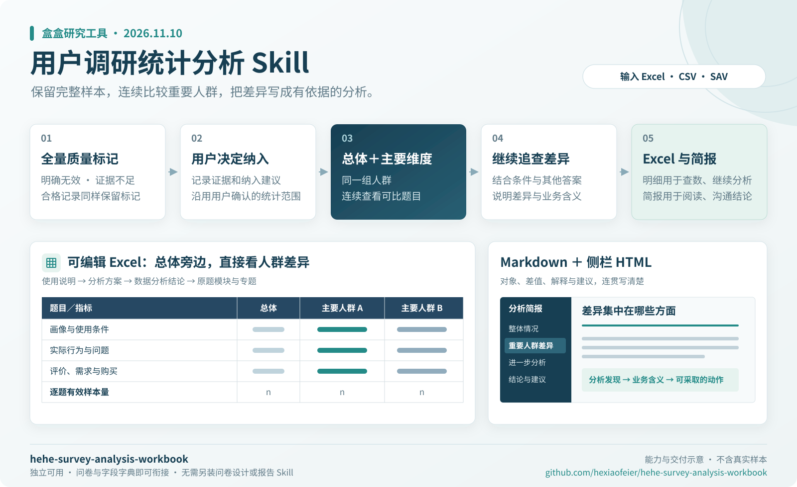
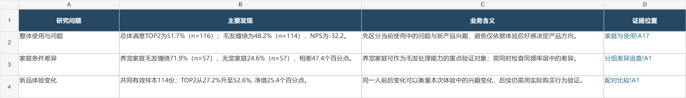
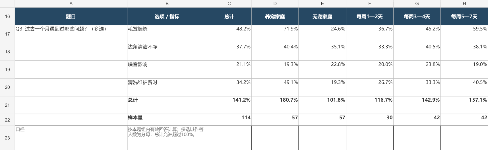
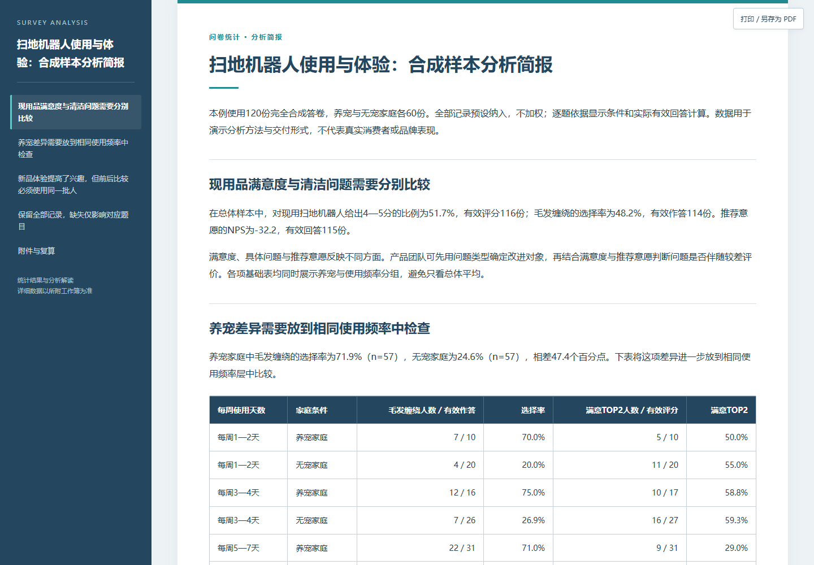

# 盒盒用户调研统计分析 Skill

> 先读清问卷，再看清人群差异。把回收数据整理成完整统计、分析解读和可继续使用的研究成果。

[](LICENSE)
[](https://agentskills.io/)
[](release-manifest.json)
[](#quick-start)
[](#inputs)
[](#delivery)

**`hehe-survey-analysis-workbook` 是盒子原创的独立用户研究 Skill。** 它检查并标记问卷回收数据，按用户确认的范围，完成逐题总体统计、重要人群的交叉分析和进一步追查，交付可编辑的 Excel 及带目录的分析简报。

适合需求调查、产品体验、满意度、竞品比较、品牌选择与后续购买研究。既可以按已有方案跑数，也可以根据研究目标、最终问卷和实际字段提出分析维度。



<p align="center">
  <a href="https://github.com/hexiaofeier/hehe-survey-analysis-workbook/releases/latest"><strong>📦 下载独立 Skill</strong></a>
  &nbsp; · &nbsp;
  <a href="#what-is-new"><strong>✨ 查看本次更新</strong></a>
  &nbsp; · &nbsp;
  <a href="#delivery"><strong>📚 交付内容</strong></a>
  &nbsp; · &nbsp;
  <a href="#quick-start"><strong>🚀 快速开始</strong></a>
</p>

<a id="what-is-new"></a>

## ✨ 2026.11.10｜从逐题结果，继续读懂不同人群

> **全量记录保留，主要维度贯穿，重要差异继续追查，分析结果直接交付。**

这次更新补齐了样本处理与分析解读，并加入随包的基础计算脚本和侧栏 HTML 简报。

| 更新 | 具体做法 | 对研究工作的帮助 |
|---|---|---|
| **全量标记，由用户决定纳入** | 每条记录标为“明确无效／证据不足／合格”，分别保留异常依据、Agent建议和用户决定 | 能看到疑点在哪里，也能比较不同处理选择的影响；原始记录保留 |
| **主要维度贯穿原题模块** | 从使用条件、行为阶段、需求及购买条件中选择重要分组，在可比题目的总体旁并列呈现 | 从画像、行为到需求和评价，都能连续查看同类人群 |
| **差异继续用现有答案追查** | 在相同条件内比较、组合多道题，或把汇总指标拆回具体组成项 | 解释差异落在哪里，以及可能改变哪项产品、服务或研究安排 |
| **完整分析提供阅读简报** | Excel保留逐题明细，同内容MD／HTML概括发现、差值与业务含义 | 查数据和读分析分别有合适的载体，HTML自带左侧目录 |
| **成品保存后再核对** | 重新读取工作簿数值、表头、样本量及真实链接；打开网页检查阅读和附件 | 检查覆盖实际交付文件，计算和呈现分别复核 |

基础统计、题序与选项顺序、权重、独立／配对比较及适用专题方法继续保留。此次也移除了对特定企业 Excel 风格的调用，使用随包的通用表格规范。

### 打开成果，看完整体，也能继续看人群

下面展示随仓库提供的合成扫地机器人示例：

| 可继续取数的统计明细 | 贯穿原题模块的人群比较 |
|---|---|
|  |  |



## 一份问卷，可以沿着同一组人读下去

以扫地机器人研究为例，除了整体问题发生率，还可以比较养宠与无宠家庭、不同使用频率的人群：他们使用设备的方式是否不同，痛点集中在哪些环节，满意度和后续选择又有什么联系。

| 分析工作 | Skill具体执行的动作 |
|---|---|
| **确定重要维度** | 明确变量测量什么、怎样分组、预计影响哪些行为或需求，以及比较对当前决策有什么用途 |
| **保留逐题整体结果** | 原问卷范围内的题目按模块、题号和确认的选项顺序呈现，每题使用自己的有效回答人数 |
| **贯穿主要人群** | 在可比较模块中，总体与主要分组并列；不适用、未编码或缺字段的题保留位置并说明原因 |
| **追查值得解释的差异** | 按问题继续分层、做同人状态对照，或结合满意度、使用方式与问题经历核对原判断 |
| **形成有用解读** | 说明对象、差多少、差异集中在哪里，提出有依据的产品、服务或后续研究动作 |

主要维度和专题维度各有用途：前者贯穿问卷，后者服务于局部解释。分组数量随研究问题和数据条件确定。

### 相似的变量，先分清测量内容

“当前使用”与“偏好使用”、“总从业年限”与“某种工作方式的年限”，可能提供不同解释。Skill会根据题意比较它们的作用，必要时查看共同分布，再决定分别保留还是联合分析。

需要分析多选组合时，可以形成“仅用某方式／该方式与其他方式并用／未用该方式”等互斥组，并继续保留原选项结果。同一人的现状与偏好、当前安排与未来计划，可以用完整分类对照表查看人数、适用的行／列百分比及配对样本量。

<a id="delivery"></a>

## 📚 每份交付物，都有清楚的用途

完整的“原始回收数据处理＋分析”任务通常交付以下内容；已有样本检查结果时直接承接其版本和用户决定。

| 交付物 | 文件形式 | 打开后看什么 |
|---|---|---|
| **样本检查工作簿** | `.xlsx` | 全量记录、正常与异常标记、证据、规则、字段字典、纳入建议及用户决定 |
| **统计分析工作簿** | `.xlsx` | 按原题模块排列的总体与分组结果、专题、数据分析结论及可点击目录 |
| **分析简报** | 同内容 `.md`＋`.html` | 总体发现、人群差异、进一步分析与业务含义；HTML为带侧栏目录的连续阅读版 |
| **实际计算脚本与运行说明** | `.py`或实际使用的`.R`，另附`.md`说明 | 输入输出、分母与权重、依赖及版本、执行命令、更新数据后怎样重算 |

只清洗时交样本检查与说明；仅跑数或局部查题时按本次范围交付。统计工作簿不生成图表，便于团队继续取数、制图与制作报告。

### Excel先给使用说明，再给分析方案

| 工作表位置 | 用途 |
|---|---|
| **第1张：使用说明** | 看研究对象、纳入范围和口径，点击目录进入对应结果 |
| **第2张：分析方案** | 看研究问题、维度选择、分组理由、指标及计算方式 |
| **数据分析结论** | 看总体发现、重要差异、追查结果与建议，直接链接明细 |
| **原题模块** | 按题号查看完整统计，总体右侧并列主要人群组 |
| **需要的专题与检查** | 查看本次实际使用的深入分析、质量摘要及开放原文 |

结果ID、变量、分子、分母和单元格位置保存在后台JSONL／CSV中，供独立复算和下游取数，不加入交付Excel。

### 一道题，一套明确的回答人群

| 题目 | 选项／指标 | 总计 | 养宠家庭 | 无宠家庭 |
|---|---|---:|---:|---:|
| 题干仅在首行显示 | 选项1 | 比例 | 比例 | 比例 |
|  | 选项2 | 比例 | 比例 | 比例 |
|  | 总计 | 合计比例 | 合计比例 | 合计比例 |
|  | 样本量 | 有效人数 | 组内有效人数 | 组内有效人数 |

深蓝白字表头、白底细灰边框，题目与选项左对齐，数字右对齐；总计和样本量加粗。单选完整分布合计100%，多选选择率合计可以超过100%。未展示、未答和有效未选分别处理；加权结果同时保留实际样本量及权重和。

### HTML简报，适合连续阅读

深蓝侧栏、青色强调、白底正文；二三级标题生成目录，桌面固定显示，窄屏可折叠。表格可局部横向滚动，图片按需内嵌；样式与交互随文件保存，可以离线打开。打印按A4自然分页，保留背景色。

简报从研究问题展开，说明主要发现、差异与理由，并指向Excel中的明细。正文保留必要对象、条件和解释。

<a id="inputs"></a>

## 准备材料，也可以从现有成果接着做

| 材料 | 用途 |
|---|---|
| **Excel、CSV或SAV回收文件** | 取得答案及原始记录；说明一行代表受访者、答卷还是一次任务 |
| **最终问卷、题目字典或平台元数据** | 确认题型、编码、选项顺序、显示逻辑与变量含义 |
| **研究目的及已有分析要求** | 确定要支持的判断、重要比较与重点模块 |
| **已有质量记录与纳入决定** | 延续用户已经确认的样本范围，不重复确认整份方案 |
| **权重、配额及抽样说明（如有）** | 确定加权方法与结果适用范围 |

SAV优先读取变量标签和值标签。缺少材料时，先完成题意和口径明确的部分；影响样本、分组或分母的疑问集中确认。

### 问卷设计与数据分析，通过材料配合

设计阶段，可以使用独立的[盒盒问卷设计Skill](https://github.com/hexiaofeier/hehe-survey-question-design)，提前把研究问题、可测变量、交叉维度、题目用途及字段定义对应起来。数据回收后，本Skill读取最终问卷与实际字段，落实本次分析方案。

使用其他工具或人工设计的问卷同样可以分析。两个Skill均可独立安装，交接依靠问卷、字段字典和已确认要求；材料调整后，按最终版本继续。

## 支持的分析，按研究问题选择

| 分析类型 | 常见内容 |
|---|---|
| **逐题基础统计** | 单选、多选、矩阵、量表分布、TOP2、均值、排序、开放题编码频次 |
| **人群比较** | 列／行百分比、共同条件下比较、独立与配对检验、多重比较校正 |
| **样本与权重** | 逐题有效人数、质量影响对照、加权比例与均值、实际人数和权重和 |
| **状态与选择专题** | 同人分类对照、NPS、漏斗、品牌与留存、合并题目及纵向比较 |
| **按需深入** | 量表合成、驱动因素、人群细分、价格与取舍研究等数据支持的专题 |

随包基础脚本处理单选、多选、量表及指定交叉组；其他题型与专题按方法参考编写相应项目脚本。完整方法见[统计口径与方法选择](skills/hehe-survey-analysis-workbook/references/statistical-methods.md)和[专项分析计算参考](skills/hehe-survey-analysis-workbook/references/special-analysis-methods.md)。

<a id="quick-start"></a>

## 🚀 安装与开始使用

仓库只包含一个独立Skill：`hehe-survey-analysis-workbook`。

在[Releases](https://github.com/hexiaofeier/hehe-survey-analysis-workbook/releases/latest)下载独立安装包，解压后将包内 `skills/hehe-survey-analysis-workbook/` 整个目录放入客户端的Skills目录。也可以克隆仓库：

```bash
git clone https://github.com/hexiaofeier/hehe-survey-analysis-workbook.git
```

将 `skills/hehe-survey-analysis-workbook/` **整个文件夹**复制到客户端配置的Skills目录，保留其子目录：

```text
你的Skills目录/
└── hehe-survey-analysis-workbook/
    ├── SKILL.md
    ├── agents/openai.yaml
    ├── references/                 # 随包的分析、清洗与交付参考
    ├── scripts/
    │   ├── basic_statistics.py
    │   └── render_brief.py
    └── assets/brief.html
```

Codex通常使用 `~/.codex/skills/`，Claude Code通常使用 `~/.claude/skills/`，以客户端当前配置为准。更新时替换完整同名目录并新开会话。

### 从原始回收数据开始

```text
使用 $hehe-survey-analysis-workbook 检查这份问卷CSV与题目字典。
保留全部记录并给出正常或异常标记，说明依据和纳入建议。
我确认纳入范围后，接着分析整体情况，以及养宠条件、使用频率
对应的行为、问题、满意度和后续购买差异。
完整交付样本检查、统计Excel、MD与侧栏HTML简报及复跑文件。
```

### 数据已经检查，直接做完整分析

```text
使用 $hehe-survey-analysis-workbook 分析这份SAV与最终问卷。
附件已明确全量纳入和质量标记，沿用这一决定，不加权。
请根据研究目的提出有业务意义的主要交叉维度，贯穿可比原题，
对重要差异继续用现有字段追查，最后给出分析解释和建议。
交付无图表Excel、MD与带侧栏目录的HTML简报。
```

### 只核对局部问题

```text
使用 $hehe-survey-analysis-workbook 核对Q12与Q18。
比较体验前后同一人的选择，保留有效配对人数、变化和差值。
这次只交这两个题的结果与口径说明。
```

### 制作端依赖，按实际任务准备

| 任务 | 所需能力／依赖 |
|---|---|
| 使用随包基础统计脚本 | Python 3.10+；CSV路径使用标准库，SAV另需`pyreadstat`和`pandas` |
| 生成随包HTML简报 | Python 3.10+、`markdown`、`beautifulsoup4`；收到成果的人只需浏览器 |
| 制作Excel | Agent已有的电子表格工具，或Python表格制作库；实际采用的依赖与版本随项目说明交付 |
| 使用检验或其他模型 | 按方法选择`scipy`、`statsmodels`或适用R环境等，常规基础统计不要求全部安装 |

本Skill可以独立运行，不需要另装问卷设计、报告写作、报告呈现Skill或付费API。

## 公开示例与复算

仓库的[扫地机器人示例](examples/robot-vacuum/README.md)使用合成答卷，展示题目、分组、缺失和配对口径。示例数据与结果只用于演示。

| 文件 | 用途 |
|---|---|
| [responses.csv](examples/robot-vacuum/responses.csv) | 查看可分享的合成答卷 |
| [sample-review.xlsx](examples/robot-vacuum/sample-review.xlsx) | 查看全量质量标记、依据及纳入决定 |
| [survey-analysis.xlsx](examples/robot-vacuum/survey-analysis.xlsx) | 打开示例统计工作簿 |
| [analysis-brief.md](examples/robot-vacuum/analysis-brief.md)／[analysis-brief.html](examples/robot-vacuum/analysis-brief.html) | 查看同内容的文本与侧栏网页简报 |
| [示例说明](examples/robot-vacuum/README.md) | 对照问卷、字段及分析口径 |
| [示例复算脚本](scripts/analyze_example.py) | 从示例CSV重新计算结果 |

在仓库根目录运行：

```bash
python scripts/analyze_example.py --output recomputed
python scripts/validate_release.py
```

实际项目沿用自己的问卷和确认口径，随结果保存计算脚本；发布检查核对随包文件、名称、引用及示例结果。私有样本、个人信息和客户资料不进入本仓库。

## 更新记录

### 2026.11.10 · v2026.11.10-v1

- 将样本检查和全量质量标记纳入独立工作流，由用户决定统计纳入范围。
- 以全样本整体分析和重要人群交叉为基础，主要维度贯穿可比模块，局部任务保留指定范围。
- 增加相近变量辨析、多选使用组合、完整分类对照，以及把汇总差异拆回原组成项的方法。
- 完整解读结合多道题与进一步分层，说明总体、人群共性与差异，并提出对应行动。
- 默认统计工作簿前两表为使用说明和分析方案，后台索引另存，采用通用可编辑表格格式。
- 完整分析交付同内容Markdown与带侧栏目录的下拉HTML，随包提供基础计算、渲染脚本和模板。
- 补充保存后工作簿数值、表头、样本量和实际链接的核对要求。

### 2026.10.05 · 首版

独立发布 `hehe-survey-analysis-workbook`，保留题型、题序、交叉、适用专题与无图表Excel交付，提供合成示例和复算工具。

## 盒盒研究工具

[盒盒问卷设计Skill](https://github.com/hexiaofeier/hehe-survey-question-design) · [盒盒行业研究技能包](https://github.com/hexiaofeier/hehe-industry-research-skill-pack) · [盒盒发展潜力评估Skill](https://github.com/hexiaofeier/hehe-development-potential-assessment)

**作者：盒子 · hehe** ｜ [GitHub](https://github.com/hexiaofeier) ｜ [反馈问题](https://github.com/hexiaofeier/hehe-survey-analysis-workbook/issues)

欢迎带着研究目的、匿名化字段与最小复现例反馈问题。项目采用 [MIT License](LICENSE)。
